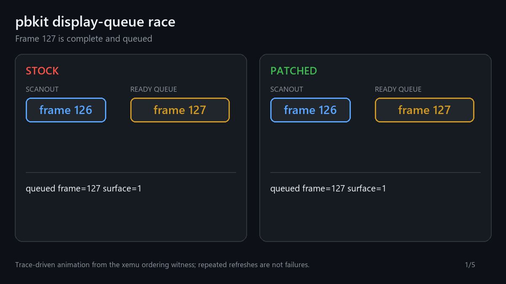

# pbkit frame-queue hardware test



This QA-only sample renders numbered frames without a game ROM. Its private
pbkit core wrapper records queue, scanout-selection, removal and deferral events
in a fixed in-memory trace. The program writes the trace only after the run.
A repeated refresh is reported separately and is not a failure. A removal whose
target does not match `PCRTC_START` is a failure.

The upstream PR contains only the production fix. This sample lives on the
separate `codex/pbkit-display-queue-qa` branch so its instrumentation cannot
expand the production diff.

Build each binary from a clean sample directory so variant-specific compiler
flags cannot reuse an object from the other variant:

```sh
eval "$(../../bin/activate -s)"
make clean && make VARIANT=stock MODE=480p REFRESHES=3600
make clean && make VARIANT=patched MODE=480p REFRESHES=3600
```

Use `MODE=720p` only when the attached Xbox video path and dashboard settings
support it. Each launch creates the next unused
`D:\\pbkit-queue-<variant>-<mode>-NN.csv` file, preserving earlier runs.
After the result file is closed, the test waits one second and quick-reboots to
the configured dashboard so a stock-patched-stock sequence can run without a
dashboard-specific in-game-reset chord.
After retrieving a result, print its summary and the first short ordering witness
with `python analyze.py <result.csv>`. A stock run with no witness is reported
plainly rather than treated as proof that the bug cannot occur.

`make_ordering_gif.py` regenerates the trace-driven animation used by the draft
PR. It illustrates the short xemu witness recorded in `HARDWARE_RESULTS.md`; it
is not a simulation or a substitute for the CSV results.
